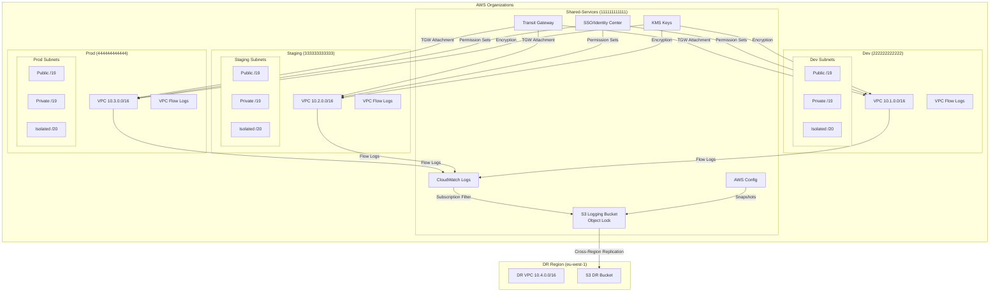

# SecondWave — AWS Landing Zone

**Enterprise-grade, FCA-compliant AWS multi-account infrastructure for a 200-person UK fintech.**

> **Scenario:** SecondWave is a London-based fintech scaling from 50 to 200 employees.
> They process financial transactions regulated by the FCA and need to migrate from
> a single-account "prod" setup to a Well-Architected multi-account landing zone.
> Four squads (Platform, CoreBanking, Digital, Data) require isolated environments
> with centralized networking, encryption, and compliance controls.

## Architecture



## Architecture Decisions

| Decision | Choice | Rationale |
|----------|--------|-----------|
| **Cross-VPC connectivity** | Transit Gateway | Transitive routing, environment isolation, scales to 1000+ VPCs (see [ADR-001](docs/ADR/001-transit-gateway-over-vpc-peering.md)) |
| **User authentication** | IAM Identity Center | Single directory, temporary credentials, IdP integration, no long-lived keys |
| **Encryption** | Per-service KMS keys | Blast radius reduction, granular auditing, per-service rotation |
| **Compliance monitoring** | AWS Config | Continuous evaluation, auto-remediation, immutable audit trail |
| **Log storage** | S3 Object Lock (Governance) | Immutable audit trail, legal hold, FCA SYSC 3.2.6R compliance |
| **VPC segmentation** | Public/Private/Isolated | Defense in depth — databases have zero internet access paths |
| **Flow logs** | Mandatory (all VPCs) | Forensic investigation, FCA network boundary monitoring |
| **Node management (EKS)** | Karpenter (planned) | Sub-second provisioning, consolidation, pod density (see [ADR-002](docs/ADR/002-karpenter-over-cluster-autoscaler.md)) |

> **SECURITY SAFEGUARD:** Every architectural decision is documented with
> rationale inside the `.tf` files using `# ARCHITECTURE DECISION:` and
> `# SECURITY SAFEGUARD:` tags. Review these for deeper context.

## Environments

| Environment | Account ID | Region | DR Region | NAT GW | VPN | Purpose |
|-------------|------------|--------|-----------|--------|-----|---------|
| **shared-services** | `111111111111` | `eu-west-2` | — | Yes | No | Central networking, logging, KMS |
| **dev** | `222222222222` | `eu-west-2` | — | No | No | Development — cost-optimized |
| **staging** | `333333333333` | `eu-west-2` | — | Yes | No | Pre-production validation |
| **prod** | `444444444444` | `eu-west-2` | `eu-west-1` | Yes | Yes | Production — FCA-regulated |

## Deployment

### Prerequisites

- Terraform >= 1.3.0
- AWS CLI configured with appropriate permissions
- AWS Organization with IAM Identity Center enabled
- Access to create S3 buckets, DynamoDB tables, and KMS keys

### Step 1: Bootstrap State Backend

```bash
cd scripts/
chmod +x bootstrap-backend.sh
./bootstrap-backend.sh
```

> **ARCHITECTURE DECISION:** The bootstrap script creates the S3 state bucket
> and DynamoDB lock table outside of Terraform (see
> [chicken-and-egg explanation](scripts/bootstrap-backend.sh)).
> After bootstrap, uncomment the `backend "s3"` block in `versions.tf`.

### Step 2: Configure Variables

```bash
cp terraform.tfvars.example terraform.tfvars
# Edit terraform.tfvars with your account IDs and configuration
# SECURITY SAFEGUARD: Never commit terraform.tfvars with real values
```

### Step 3: Plan

```bash
# For dev environment:
terraform init -backend-config="envs/dev/backend.hcl"
terraform plan -var-file="envs/dev/terraform.tfvars" -out=tfplan-dev

# For all environments:
terraform plan -var="environment=all" -out=tfplan-all
```

### Step 4: Apply

```bash
# Dev (safe, no approval needed):
terraform apply tfplan-dev

# Staging/Prod (via CI/CD with manual approval):
# See .github/workflows/terraform-apply.yml
```

## CI/CD Pipeline

```yaml
Pull Request:
  ├── Terraform Init
  ├── Terraform Validate
  ├── TFLint       (AWS-specific linting)
  ├── Checkov      (CKV_AWS security scan)
  ├── Infracost    (cost estimation, GBP)
  └── Terraform Plan → PR Comment

Apply (workflow_dispatch):
  ├── Dev:  Auto-apply on approval
  ├── Staging: Manual approval via GitHub Environments
  └── Prod:  Manual approval + break-glass procedure
```

> **SECURITY SAFEGUARD:** OIDC keyless authentication — no static AWS credentials
> stored in GitHub Secrets. The OIDC provider trusts only this repository.

## Production Safeguards

> **SECURITY SAFEGUARD: Immutable Audit Trail**
> All logs (VPC Flow Logs, CloudTrail, Config) converge to the S3 logging
> bucket with Object Lock in GOVERNANCE mode. 365-day retention minimum,
> transitioning to Glacier for 7-year FCA compliance.

> **SECURITY SAFEGUARD: Network Segmentation**
> Isolated subnets (databases) have zero internet access — no route to IGW
> or NAT. VPC Endpoints (Gateway) provide access to S3 and DynamoDB.
> Transit Gateway route tables prevent non-production from reaching prod.

> **SECURITY SAFEGUARD: Least-Privilege Access**
> IAM Identity Center enforces temporary credentials (1-12h sessions).
> No IAM users in workload accounts. Permission sets per squad with
> only the permissions each squad needs. MFA required for all users.

> **SECURITY SAFEGUARD: Encryption Everywhere**
> Per-service KMS CMKs with automatic annual rotation. EBS volumes must be
> encrypted (Config rule). RDS storage must be encrypted (Config rule).
> S3 buckets enforce TLS for all requests.

> **SECURITY SAFEGUARD: Continuous Compliance**
> AWS Config rules evaluate every resource change. Non-compliant resources
> trigger alarms within 5 minutes. SCPs prevent disabling Config, CloudTrail,
> or modifying Object Lock settings.

## Trade-offs and Alternatives

### Transit Gateway vs. VPC Peering
- **TGW:** Higher base cost (~$66/mo/attachment) but scales linearly with VPCs.
- **VPC Peering:** Free connections, but full mesh requires 45 peerings for 10 VPCs.
- **Our choice:** TGW — the operational burden of managing peering at scale outweighs cost.

### KMS per-service keys vs. single key
- **Per-service:** Higher KMS request cost, more key policies to manage.
- **Single key:** Simpler but critical vulnerability — compromise of one key exposes all data.
- **Our choice:** Per-service — blast radius reduction is worth the complexity.

### S3 Object Lock vs. Glacier Vault Lock
- **Object Lock:** Flexible — Governance mode can be adjusted; works with Standard/IA/Glacier.
- **Glacier Vault Lock:** Permanent — can't be removed at all; only works with Glacier.
- **Our choice:** Object Lock — flexibility for compliance adjustments and lifecycle transitions.

### IAM Identity Center vs. IAM users
- **Identity Center:** Requires AWS Organizations; adds complexity for small orgs.
- **IAM users:** Simpler for single-account but doesn't scale to multi-account.
- **Our choice:** Identity Center — necessary for multi-account SSO and audit compliance.

## Disaster Recovery

| Service | RTO | RPO | Method |
|---------|-----|-----|--------|
| **S3 logs** | 4 hours | 1 hour | S3 Cross-Region Replication (RTC) |
| **Terraform state** | 1 hour | 24 hours | S3 Versioning + DynamoDB backup |
| **IAM Identity Center** | 1 hour | N/A | IdP-initiated provisioning (SCIM) |
| **AWS Config** | 4 hours | 6 hours | Config Aggregator in DR region |

See [S3 Cross-Region Restore Runbook](docs/runbooks/s3-cross-region-restore.md)
and [State Recovery Runbook](docs/runbooks/state-recovery.md) for detailed procedures.

## Cost Governance

- **Infracost** estimates costs for every PR in GBP (£).
- **NAT Gateways** are disabled in dev (~£30/mo savings).
- **VPC Endpoints** (Gateway) are free — used instead of NAT for S3 access.
- **Lifecycle policies** transition logs to Glacier after 90 days.
- **Object Lock** prevents orphaned resources from being deleted — review retention policies.

## Directory Structure

```
landing-zone/
├── modules/
│   ├── vpc/                   # VPC with public/private/isolated subnets + flow logs
│   ├── transit-gateway/       # TGW with route tables, attachments, propagation
│   ├── iam-identity-center/   # Permission sets per squad + account assignments
│   ├── kms/                   # Per-service multi-key KMS hierarchy
│   ├── config/                # AWS Config rules (S3, EBS, RDS, VPC, IAM)
│   └── logging/               # S3 Object Lock bucket + CloudWatch destination
├── envs/
│   ├── dev/                   # Backend config + tfvars
│   ├── staging/               # Backend config + tfvars
│   └── prod/                  # Backend config + tfvars (multi-region DR)
├── scripts/
│   └── bootstrap-backend.sh   # Creates S3 + DynamoDB state backend
├── docs/
│   ├── ADR/                   # Architecture Decision Records
│   └── runbooks/              # Operational runbooks (S3 DR, state recovery)
├── observability/
│   ├── adot-collector-config.yaml  # OpenTelemetry collector config
│   ├── dashboard.json              # CloudWatch dashboard definition
│   └── alarms.json                # Composite alarm definitions
├── tests/
│   ├── vpc_test.go            # Terratest VPC module validation
│   └── iam_test.go            # Terratest IAM + KMS module validation
├── .github/workflows/
│   ├── terraform-plan.yml     # OIDC CI: validate, lint, scan, plan
│   └── terraform-apply.yml    # OIDC CD: apply with manual approval gates
├── main.tf                    # Root module
├── variables.tf               # All variables
├── outputs.tf                 # All outputs
├── versions.tf                # Terraform + provider versions
└── terraform.tfvars.example   # Example configuration
```

## Repository Map (Multi-Repo Strategy)

This is **Repository 1 of 5** in the SecondWave platform:

| Repo | Focus | Status |
|------|-------|--------|
| **Repo 1 (this)** | AWS Landing Zone — VPCs, TGW, KMS, Config, SSO | Active |
| **Repo 2** | EKS Platform — Karpenter, IRSA, Ingress, Service Mesh | Planned |
| **Repo 3** | Application Patterns — Microservices, Serverless, Batch | Future |
| **Repo 4** | Pipeline — ArgoCD/Flux, Kustomize/Helm, Feature Flags | Future |
| **Repo 5** | Observability — Grafana, Prometheus, Loki, Tracing | Future |
